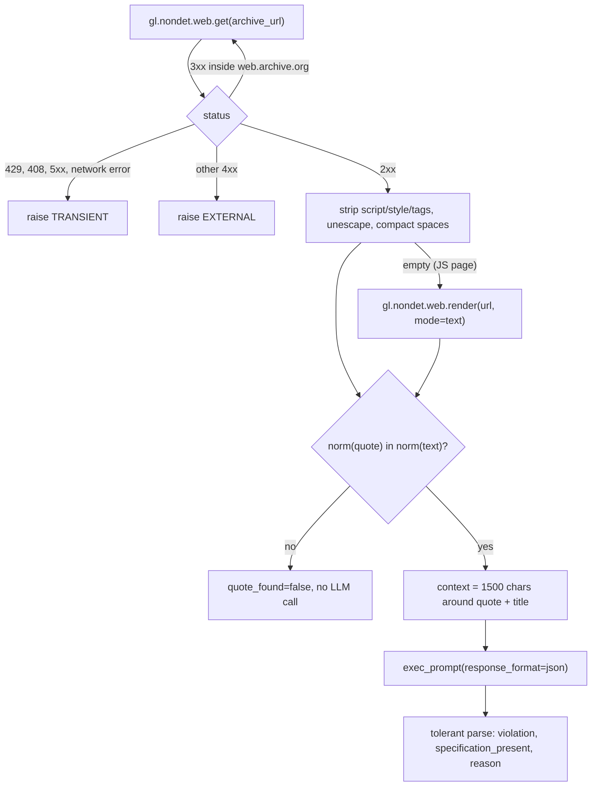
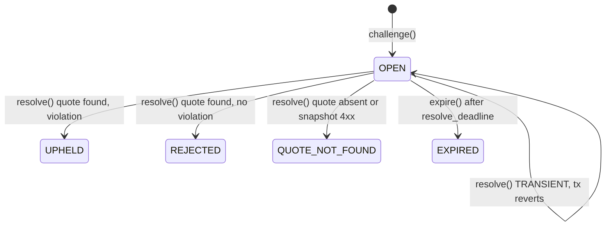

# GreenClaim Bond: architecture

One-page boundary note, written before the contract (see `SPEC.md` section 4).

**Question the contract settles:** does *this exact sentence*, on *this archived page*, break *one fixed rule* (R1, R2 or R3, inspired by Directive (EU) 2024/825)?
Everything around that single judgment (money, deadlines, quote matching, URL construction) is deterministic code.

| Layer | Owns |
|---|---|
| Frontend / backend (later) | UI, finding or creating Wayback snapshots, indexing, previews |
| **GenLayer contract** | pledges, bonds, stakes, deadlines, the evidence URL, the validator comparison rule, settlement, `standing()` |
| External source | Wayback Machine snapshot bytes (immutable, re-fetched independently by every validator) |

## 1. Action

| Who | Method | Money |
|---|---|---|
| Brand | `create_pledge(name, domain, pages_json, payout, days)` | sends the bond |
| Brand | `top_up(pledge_id)` | adds to the bond |
| Anyone except the brand | `challenge(pledge_id, page_index, rule, quote, snapshot_ts)` | sends a stake of at least `payout // 10` |
| Anyone | `resolve(challenge_id)` | none |
| Anyone | `expire(challenge_id)` | none |
| Brand | `withdraw(pledge_id)` | receives the unreserved bond |

`challenge()` makes **no AI or web call**. It only checks inputs and reserves `payout` from the bond.
So a challenge filed on time can never be lost to an outage.

## 2. Proof

The evidence URL is **built by the contract**, never supplied by the user:

```
https://web.archive.org/web/{snapshot_ts}id_/{page_url}
```

- `page_url` is one of the 1 to 5 https pages fixed at pledge creation. Each one is normalized and must be on `domain` or `www.` + `domain`.
- `snapshot_ts` is 14 digits. It must be no later than the challenge time and no earlier than the pledge creation.
- The `id_` suffix returns the original bytes without the Wayback toolbar. A snapshot never changes, so every validator reads the same document.
- **Redirects:** Wayback answers with a 3xx to the nearest capture. The SDK `Response` exposes no final URL and redirect behaviour is undocumented, so the contract follows at most 2 hops itself. It only follows a `Location` that stays on `web.archive.org/web/<14 digits>id_/` and points at the same page.

## 3. Non-deterministic call (leader)

Before the block, `resolve()` copies plain strings into locals: archive URL, page URL, quote, rule.
Storage is never read inside the block.



- **Normalization (`norm`):** NFKC, curly quotes and guillemets unified, dashes unified, lowercase, whitespace compacted.
- **Prompt:** the template from SPEC 4.5, built entirely in code.
  - The rule text is a constant (`RULE_TEXT`).
  - The quote and page context sit between `<quote>` and `<page_context>` tags, with `<` and `>` neutralized so page content cannot close a tag.
- **LLM output:** only two booleans matter. A non-dict or an unparsable `violation` raises `[LLM_ERROR]`.

## 4. Equivalence

`gl.vm.run_nondet_unsafe(leader_fn, validator_fn)`. No `strict_eq` on LLM output, and no `prompt_*` wrapper.

`validator_fn(leaders_res)`:
- **Leader errored:** the canonical handler from the `write-contract` skill applies.
  - `[EXPECTED]` / `[EXTERNAL]`: the validator re-runs the block and must hit the identical message.
  - `[TRANSIENT]` on both sides: agree.
  - `[LLM_ERROR]` or unknown: disagree, which triggers leader rotation.
- **Leader returned:** the validator **re-runs the whole task** (fetch, extract, match, LLM). It agrees only if `quote_found` **and** `violation` are equal.
- **Not compared:** `reason` and `specification_present` are free text or advisory and are not part of the settlement.

This is never a format-only check: the validator produces its own answer from the same immutable source.

## 5. State

```python
Pledge:    brand, name, domain, pages[1..5], bond, reserved, payout, min_stake, ends_at, active, created_at
Challenge: pledge_id, page_index, rule, quote, snapshot_ts, challenger, stake, status, reason, opened_at, resolve_deadline
GreenClaimBond: pledges, challenges, next_pledge, next_challenge, open_keys, pool
```

- **Types:** amounts are `u256` in wei, never floats. Times are ISO-8601 UTC strings computed from `datetime.now(timezone.utc)`, which is the transaction time and is computed outside nondet blocks.
- **Duplicates:** `open_keys["{pledge}:{page}:{rule}"]` blocks a second OPEN challenge on the same page and rule.
- **Invariant:** `reserved <= bond`. Every open challenge holds exactly one `payout` in `reserved`.
- **`pool`:** a cumulative counter of lost stakes. The stakes themselves are credited to the challenged pledge's bond.
- **Deviation from SPEC 4.3:** `Pledge.created_at` is added, as the last field. The rule "snapshot >= pledge creation" needs it.

## 6. Settlement (deterministic, outside the nondet block)



| Outcome | Bond / reserve | Challenger | Brand |
|---|---|---|---|
| UPHELD | `bond -= payout`, `reserved -= payout` | receives `stake + payout` | - |
| REJECTED | `reserved -= payout`, `bond += stake`, `pool += stake` | loses stake | bond grows by the stake |
| QUOTE_NOT_FOUND | same as REJECTED | loses stake | bond grows by the stake |
| EXPIRED | `reserved -= payout` | stake refunded | - |

**Timing**
- `resolve` works only until `resolve_deadline`, which is `opened_at` + 3 days. After that only `expire` works, so the two never race.
- **Transient failure:** the transaction reverts and the challenge stays OPEN, so anyone can retry until the deadline.
- **404 snapshot:** the leader raises `[EXTERNAL]`, validators must agree on the same message, and `resolve()` catches it after consensus and settles QUOTE_NOT_FOUND.

**Wallet payouts:** `@gl.evm.contract_interface class _Recipient` + `emit_transfer(value=...)`. Transfers are emitted after every state update.

**`withdraw`:** brand only, after `ends_at`, and limited to `bond - reserved`. Open challenges stay fully covered.

## Verified platform facts (23/10/2026, pinned runner `py-genlayer:1jb45aa8...`)

- **Web response:** `gl.nondet.web.get` returns `Response(status, headers: dict[str, bytes], body: bytes | None)`. The field is `status`, not `status_code`. Network failures raise a non-exported `NondetException`.
- **Errors:** `gl.vm.UserError.__str__` returns its repr, so the contract compares `.message` and looks for prefixes anywhere in the message.
- **Nondet call:** `gl.vm.run_nondet_unsafe` exists in this runner (renamed `run_nondet` in SDK v0.3). A validator exception counts as disagreement.
- **LLM call:** `exec_prompt(..., response_format="json")` returns a parsed dict, which is still validated.
- **Wallet transfers:** an EOA transfer is an `EthSend` through the IC's ghost contract, executed on finalization. In Studio, balances are simulated.
- **Sending value from tools:**
  - The `genlayer` CLI `write` cannot attach a message value; `--fee-value` is the fee deposit.
  - `--args` runs `JSON.parse` on each argument, so a JSON-looking string becomes a list.
  - Payable calls therefore go through genlayer-js `writeContract({ value })` (see `scripts/greenclaim.ts`) or gltest `.transact(value=...)`.
- **Phase 2 support:** only `genlayer@0.40.0-rc.5` and `genlayer-js@2.0.0-rc.2` ship the Bradbury Phase 2 presets. The stable lines and the Python tooling still point at `rpc-bradbury`.
